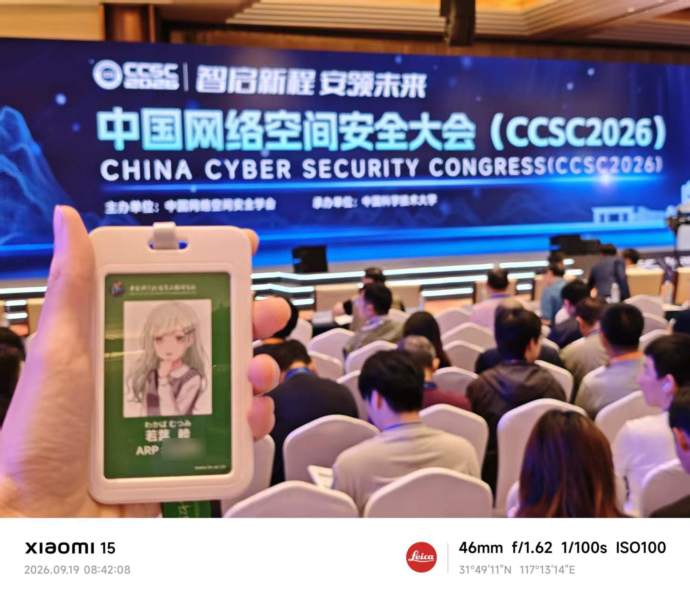

From 18 to 20 September 2026, I attended the 1st **China Cyber Security Congress (CCSC 2026)** in Hefei as a student member. The congress was hosted by the China Cyber Security Society (CCSS) and organized by the University of Science and Technology of China (USTC).

## Forum programme

On 19 September I attended the opening ceremony and the main forum, followed by five thematic forums:

- *Open Source Software and Supply Chain Security (开源软件与供应链安全论坛)*
- *AI-Empowered Systems Engineering Security (智能赋能的系统工程安全论坛)*
- *Intelligent Cryptography (智能密码论坛)*
- *Cybersecurity and Cryptography Integration (网密融合论坛)*
- *AI–Security Integration and Mutual Empowerment: Co-building a New Ecosystem for Autonomous Cyber Offense and Defense Large Models (智安融合 · 双向赋能｜协同构建自主网络攻防大模型新生态论坛)*

The forums covered supply-chain risk in open-source software, the security of AI-enabled systems, and the integration of cryptographic and AI methods into defensive practice.

I also visited the USTC campus during the trip.
